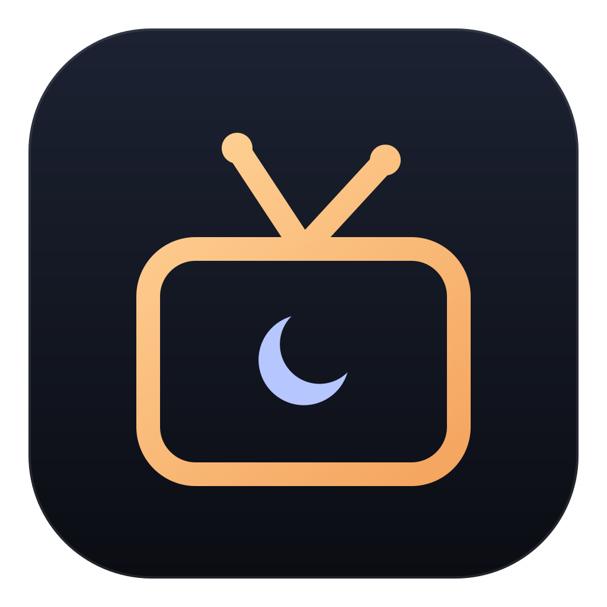

<p align="center"></p>

# Antenne

French live TV for [Nightglass](https://github.com/MarcDownHQ/nightglass), without DRM.

Antenne is a Nightglass plugin: a WebAssembly component that adds a source of 95 French live channels. The national
public channels and the France 3 editions come from France Télévisions, CNews, L'Équipe, T18 and the radios with a
video live from Dailymotion, BFM TV and its local channels from bfmtv.com, plus Equidia, KTO, local stations and a
few overseas channels. Every address is found at play time, since most are signed and short-lived.

**Status: 0.1.0, not released yet.** A live check over all 95 channels on 2026-11-20 played every one end to end,
T18 on a second try: a Dailymotion live fails to start about once in twenty plays, until the Nightglass relay
retries a refused master (see [TODO.md](TODO.md)). No replay and no programme guide yet (see
[ROADMAP.md](ROADMAP.md)).

## Install

Download `antenne.wasm` from the latest
[GitHub release](https://github.com/MarcDownHQ/Antenne/releases) into Nightglass's plugin folder:

- Windows: `%APPDATA%\com.marcdownhq.nightglass\plugins`
- macOS: `~/Library/Application Support/com.marcdownhq.nightglass/plugins`
- Linux: `~/.local/share/com.marcdownhq.nightglass/plugins`

Restart Nightglass, then add a source of type Antenne (one click, from its preset). It has no settings.

## How it works

`load-catalog` returns a channel table compiled into the plugin, grouped (National, News, Sport, Thematic,
International, Radio, Regional, Overseas, Local), with the national TNT numbers and logos. `stream-url` resolves the
channel when it is played:

- **France Télévisions**: the k7 descriptor names the live's HLS master, hdfauth signs it.
- **Dailymotion**: the player metadata gives a signed master, played whole (its audio is in separate renditions)
  through the Nightglass relay with a browser handshake. The relay's filter cuts the master down to one encoder,
  since many masters list a primary and a backup side by side on unrelated timelines.
- **BFM**: the live page names a static master.
- **The rest**: Kick, the Equidia racing API, EasyBroadcast, `HDR_VISIO` and Ultimedia players, TV Monaco's API,
  and a few fixed addresses.

Details live in [brain/](brain/BRAIN.md). Everything Antenne knows about these services comes from observing them.

## Development

```bash
cargo fmt --all
cargo clippy --all-targets -- -D warnings
cargo clippy --target wasm32-wasip2 --release -- -D warnings
cargo test
scripts/coverage.sh --check                       # 98% of lines
cargo build --release --target wasm32-wasip2       # target/wasm32-wasip2/release/antenne.wasm
cargo run -p antenne-smoke --release -- cnews france-2 bfmtv   # against the live services
```

The toolchain (Rust with the `wasm32-wasip2` target) is pinned in `rust-toolchain.toml` and `.mise.toml`.

## Licence

MIT, see [LICENSE](LICENSE). `wit/provider.wit` comes from Nightglass, MIT as well.
